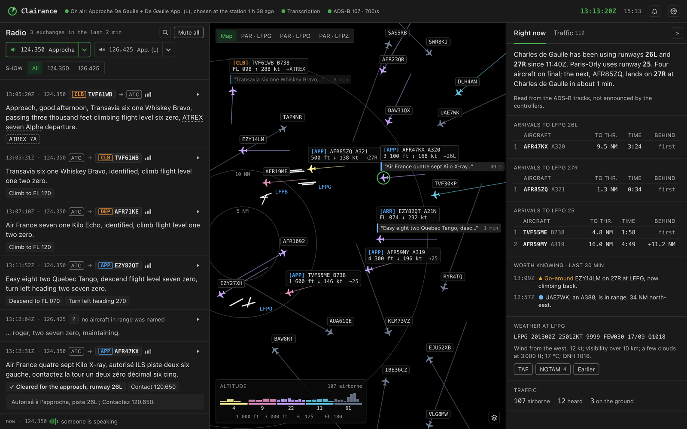
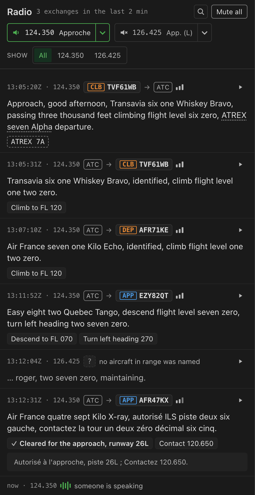
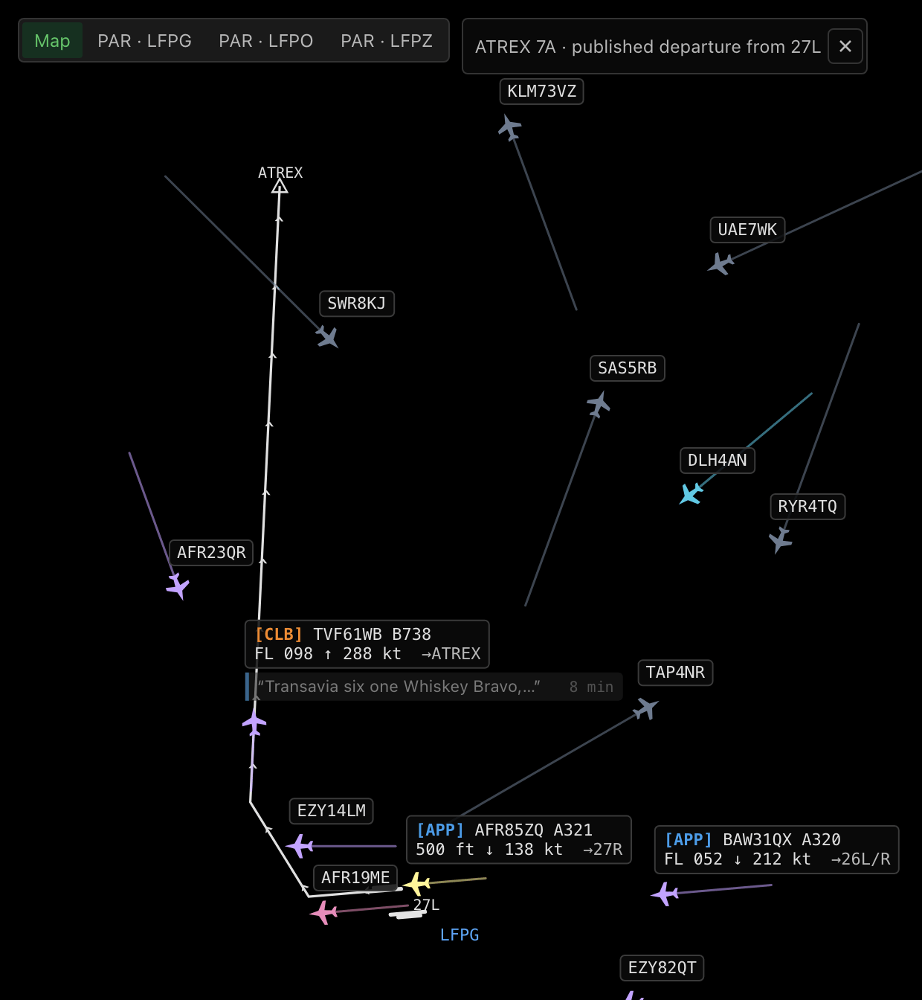
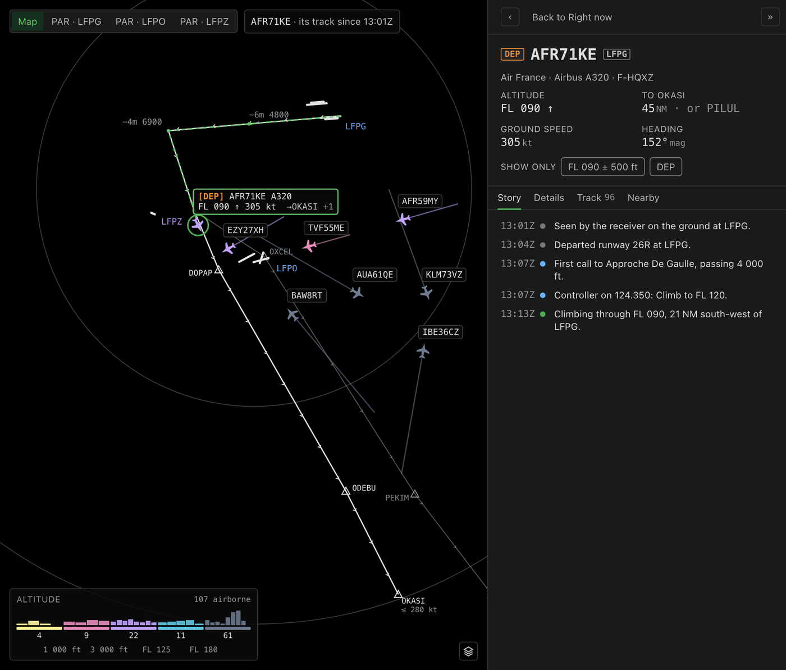
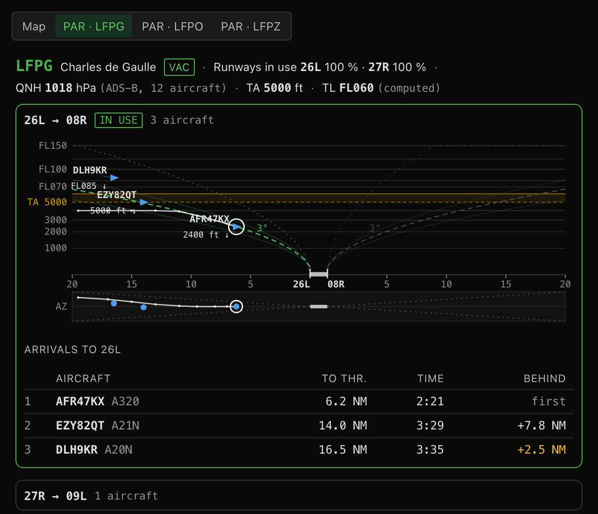
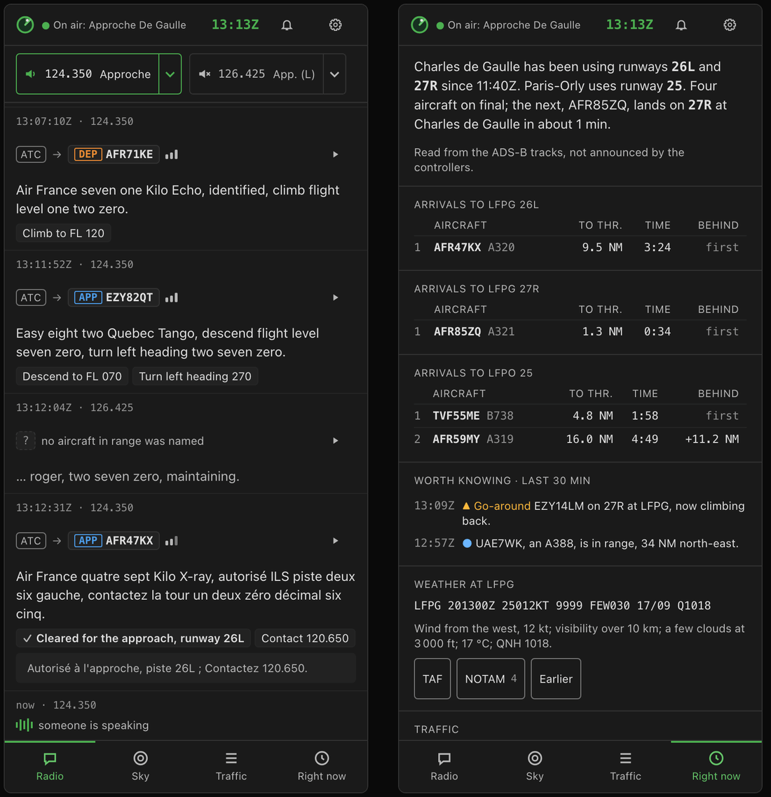
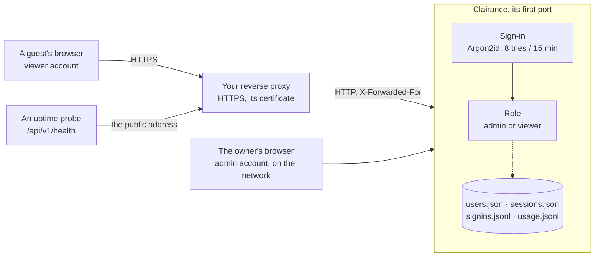
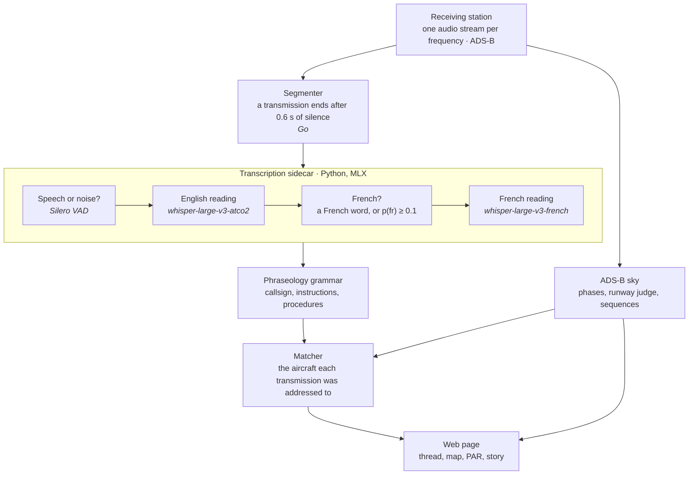

<picture>
  <source media="(prefers-color-scheme: light)" srcset="www/brand/signe-clair.svg">
  
</picture>

# Clairance

**Listen to the air traffic control radio around you, read it, and see which aircraft
is speaking. Everything is transcribed on your own Mac: no audio leaves the house.**

A receiving station near an airport picks up two things at once: the positions that
aircraft broadcast every second (ADS-B), and the voices of pilots and controllers on
the airband. Clairance joins the two. It transcribes each transmission, in English and
in French, works out which aircraft it was addressed to, says in plain words what was
asked, and draws the traffic as a controller would read it: the runway in use, the
arrival sequence, where each departure is heading.

It is made for the listener. It explains; it never judges a pilot or a controller.



<sub>Screens composed from Clairance's design system, on the real airports and published
routes around Paris, with made-up flights and transmissions: real recordings of the airband
are not published.</sub>

---

## What it does

### Hear and read

- **Every frequency the station listens to, transcribed as it is spoken**, by Whisper
  models running on the Mac's GPU ([MLX](https://github.com/ml-explore/mlx)). An English
  model fine-tuned on air traffic control reads every transmission first; when the words
  or the sound suggest French, a French model reads it again. On this station the radio is
  half French, half English, often within one exchange.
- **A voice gate in front of the models.** At night, up to 98 % of squelch openings on some
  channels carry no speech, and a speech model fed noise does not return silence: it
  invents plausible sentences. Silero VAD drops them before they are transcribed.
- **Listen in the page** to any frequency, with its own volume; replay any past
  transmission from the archive (for the owner's account by default).

### Know who is speaking

- **Each transmission is attached to an aircraft** in the receiver's sky: the callsign is
  read from the words ("Air France four seven kilo x-ray") and matched against the aircraft
  the station can actually see, within the frequency's sector. Two close candidates and it
  refuses to choose.
- **The proof stays with it**: why this aircraft, how strong the evidence is, or why none
  was named.
- **Three measured presets** — Measured, Cautious (97 % right, fewer matches),
  Experimental — instead of eleven knobs, and the knobs are there for whoever wants them.

### Understand what was said

- **Instructions in plain words**: "Descend to FL 100", "Turn left heading 270", "Cleared
  for the approach, runway 26L", "Contact 120.650", in French for a French exchange. A phraseology
  grammar reads them, with no language model.
- **Procedures named**: when a controller says "elcope seven golf", the thread proposes
  the official name, **ELCOB 7G, a departure from De Gaulle**, read from the French AIP;
  a click draws its published route on the map.
- **French said in French**: a French exchange gets its plain reading in French too
  ("Autorisé à l'approche, piste 26L ; Contactez 120.650.").
- **What the aircraft did next**, from its track and without a verdict: "level at 4 000 ft,
  2 min later".

<p align="center"></p>

### See the traffic

- **The map**: every aircraft the receiver hears, coloured by altitude band, labelled
  lightly when zoomed out and fully when zoomed in, with the airports' runways, taxiways
  and aprons drawn from OpenStreetMap. A lost aircraft is drawn as an outline where it was
  last seen, for ten minutes by default.
- **Right now**: one sentence that says which runways are in use and since when, the
  arrival sequence per runway with the time to touchdown and the gaps, the last half
  hour's events, and the weather read out in plain words.
- **Probable runway and exit** on each label: an arrival's pair of runways from 20 NM
  ("→26L/R"), the runway itself from 15 NM ("→26L"); a departure's exit point once it has turned towards it
  ("→OKASI", or "→OKASI +2" while others remain possible). Select a departure and the
  published routes of its possible exits are drawn, following it as it flies.
- **Published procedures**: the SID and STAR of the airports you follow, as a map layer,
  for the runways in use.
- **The PAR view**: the approaches to an airport in profile, runway by runway, after the
  Precision Approach Radar scope — the glide slope, the aircraft on it, the spacing.
- **Follow a flight**: its story on one page — what it was told, what it did, its phases,
  its track, the aircraft nearby — and the map keeps it in view.
- **An event log** for what is worth knowing: an emergency squawk, a go-around, a change of
  runway in use, a rare aircraft, a frequency that went silent.

<p align="center"></p>

<p align="center"></p>

<p align="center"></p>

It works on a phone too, through the same page.

<p align="center"></p>

### Open it to a friend

- **Accounts, managed from the page.** In *Settings → Account → Accounts* the admin adds an
  account, admin or viewer, gives one a new password, cuts one off — its pages and its sound
  stop within the second — or removes it, while the server runs. A viewer reads the thread,
  the map and the transcripts, changes nothing, and hears the audio only if the server allows
  it.
- **From the Internet, behind your own reverse proxy** and over HTTPS ([below](#reaching-it-from-the-internet-behind-a-reverse-proxy)).
  Sign-ins survive a restart of the server.
- **Who came, and what they did.** Every sign-in, refused or not, is traced. *Usage* shows who
  has a page open and which frequencies they hear, and for each account over the last 7 days
  the time connected and listening, the clips played again, a bar a day, and what interrupted
  them: a restart, the station's stream ending, a connection lost and back. Kept 30 days on the
  server, with no address written.

## How well it works

Measured on the station it was built for, near Paris, with the numbers and their method
in [`docs-fr/`](docs-fr/) (in French). Matching is scored against the ADS-B: what the same
rules match in the sky of another moment is subtracted as chance. It has not yet been
checked against a sample verified by ear.

| | Result | When |
|---|---|---|
| Transmissions attached to an aircraft, "Measured" preset | **95 % right**; 2 557 attached of 8 322 transmissions in a day | 03/10/2026 |
| French second reading | **+7 to +8 %** more aircraft found, at equal precision | 28/09 |
| From the end of a transmission to its text | **1.0 s** median, 2.4 s at the 90th percentile | night of 14-15/10 |
| Runway an aircraft landed on or took off from | **1 504 of 1 505** arrivals at De Gaulle, **449 of 449** at Orly, against FlightAware | six days, end of Sept. |
| Probable runway of an arrival, at 15 NM | **96.6 % right** at De Gaulle (every error the other runway of the pair), 100 % at Orly | 2 338 arrivals, 02-16/10 |
| Probable exit of a departure, alone on the label | **93 % right at 20 NM**, for half the departures | 813 departures, 02-16/10 |
| Procedures named in the thread | **18 of 18 right** (a small sample) | the owner's listening, 16/10 |

## Limitations

Said plainly, because they matter more than the features:

- **The transcript itself is often poor.** Callsigns, numbers and instructions come through;
  the rest of the sentence often does not. Most errors are invented words, and the English
  model's are made of real air-traffic words in the wrong order. Three fine-tuning trials
  so far, none better than the model in use.
- **Reception decides a lot.** On the weaker frequencies the squelch cuts in the middle of a
  third to a half of transmissions; that is the antenna's, not the software's.
- **Coupled sectors are counted twice.** When controllers merge two frequencies in the
  evening, the same transmission arrives on both and is transcribed twice.
- **Only about a third of all transmissions get an aircraft**: the others are too short,
  too garbled, or name nobody (34.5 % on a full night, 14-15/10). What is attached is
  mostly right; what is not, is said.
- **Built around one station, near Paris.** The settings were measured on Paris approaches;
  the AIP names, procedures and approach charts come from the French eAIP and only cover
  French airports; the IGN base map is France-only (OpenStreetMap works anywhere). Outside
  France those parts are simply absent, and the settings say so. Following the station's
  channel selection (`radio-ctl-sync`) is specific to that station's control API.
- **Transcription needs Apple Silicon.** The sidecar runs on MLX. Without it the server
  still runs, with the map, ADS-B and audio, but no transcript; any service honouring
  upstream's [`docs/LOCAL-STT.md`](docs/LOCAL-STT.md) contract can replace it. A Linux and
  NVIDIA port is a target, not done; the Windows build compiles but has never been run.
- **Not yet easy to install elsewhere.** It runs, every day, on its owner's station; nobody
  else has installed it yet, and there is no installation guide beyond the one below.
- **Audio for guests is all or nothing.** `audio_replay = "all"` lets every viewer account hear
  the streams and the clips, or none of them; there is no per-account switch, and changing it
  needs a restart.
- **Probable runways and exits are inferences**, and labelled as such: nothing is shown for
  an aircraft the controller vectors off its procedure, and departures already in the air
  when the server starts have no exit.

## What leaves your machine

Nothing goes to OpenAI or any speech service: there is no API key in Clairance. What does
go out, and when:

- **Weather**: the reference airport's ICAO code, to Windy, every 10 minutes (can be turned
  off).
- **Map tiles**, fetched by your browser from IGN or OpenStreetMap; none with the "None" base
  map. The airspace layer (off by default) uses openAIP tiles.
- **The French eAIP**, from the SIA's site, only when you press "Update from the SIA" or turn
  on "Update at each new AIRAC cycle" (off by default): a few pages and the procedure coding tables of the airports you
  follow, once per 28-day cycle, kept on disk.
- **ADS-B**, only if you choose an external source (OpenSky, ADS-B Exchange through RapidAPI)
  instead of your own receiver: your position and range.
- **At setup only**: the reference files (`scripts/download_assets.sh`), the airport layout
  (OpenStreetMap's Overpass API, `tools/airport-layout/fetch.py`), and the Whisper models
  (Hugging Face).

The page itself loads nothing from a CDN. The accounts, the sessions, the sign-in trace and the
usage journal stay on the server.

## What you need

- **An ADS-B receiver** with `tar1090` or `readsb` (or an external source, see above).
- **Audio of the airband**: an MP3 stream over HTTP per frequency (Icecast, what this was
  built against, or LiveATC), or raw 16-bit PCM over UDP from an SDR program (GQRX, SDR++,
  rtl_fm). Both are read inside the server: nothing to install for the audio.
- **A Mac with Apple Silicon** for transcription (the station's runs on a Mac mini with
  24 GB; the three models take 8 GB or more), **Python 3.11+** for the sidecar, **Go 1.23+**,
  and `pdftotext` (poppler) for the procedure tables.

## Getting started

```bash
git clone https://github.com/chatelp/clairance.git
cd clairance
cp configs/config.toml.example configs/config.toml   # then set your station, sources and airports
go build -o bin/co-atc ./cmd/server
python3 -m venv .venv && .venv/bin/pip install -r sidecar/requirements.txt
```

The page is built into the binary: `bin/co-atc` serves the page of its own commit and needs
no `www/` beside it. To work on the page without rebuilding, set `[server] static_dir = "www"`.

To have the settings and the sign-in page say which build is running:

```bash
go build -ldflags "-X main.version=$(git describe --tags --match '[0-9]*' --always) -X main.commit=$(git rev-parse --short HEAD)" \
  -o bin/co-atc ./cmd/server
```

You do not start the transcription sidecar yourself: set `[transcription.local] command`
in the configuration and the server starts it, restarts it if it dies, and stops it on
exit. Leave it empty to run the server without transcription, or point `server_url` at a
sidecar running elsewhere.

```bash
./bin/co-atc -config configs/config.toml
```

Then open `http://localhost:8000`. The first visit asks whether the server is for this
machine only (no sign-in) or reachable with an account. A server that listens beyond
`127.0.0.1` without an account refuses to start.

Optional, once:

- `python3 tools/airport-layout/fetch.py --config configs/config.toml` draws the airports'
  runways, taxiways and aprons around your station (OpenStreetMap, ODbL). The file belongs to
  your station and is not built in: it is written to `station/` in the data directory
  (`[storage] sqlite_base_path`), from where the server serves it to the map.
- In *Settings → Regional data*, **Update from the SIA** fetches the official names and the
  published procedures of the French airports you follow.
- `tools/menubar/` builds **Clairance.app**, a menu-bar launcher that starts and stops
  your installation's own production script and shows every instance running. On macOS,
  start the server from it, or from a double-click, rather than from a terminal that may
  quit: the server's Local Network permission is that of the application that started it.

> The binary is still called `co-atc` and the Go module path is still upstream's. On macOS
> the Local Network permission is granted per executable, and a permission silently not
> granted looks exactly like a network outage; renaming would re-ask it on every machine.

`configs/config.toml.example` is about 170 lines; a key left out takes its default
(`internal/config/defaults.go`). At startup the server names, one line each, what it found
in the file and does not read, and what it depends on and does not find: a source it
cannot read, `pdftotext`, the sidecar's program, script and models, room on the disks,
a data directory it can write, the airport layout. Each line says what suffers; the server
starts all the same, and `/api/v1/health/detail` lists them under `missing`.

## Reaching it from the Internet, behind a reverse proxy



Clairance does not serve HTTPS to the Internet itself: put a reverse proxy in front of it
that terminates TLS and forwards in plain HTTP on your network. On the server, declare that
proxy and nothing else, and require sign-in:

```toml
[server]
host = "0.0.0.0"                    # the proxy runs on another machine: listen on the network
trusted_proxies = ["192.0.2.10"]    # the proxy's address as this server sees it, and only it
audio_replay = "owner"              # "all" to let viewer accounts hear the streams and clips
```

With the proxy declared, the server reads the browser's address and scheme from its
`X-Forwarded-For` and `X-Forwarded-Proto` (from it alone), marks the session cookie `Secure`,
points the page's audio at the page's own address rather than at ports 8001–8004, refuses
the first-run page to whatever comes through it, keeps `/api/v1/health/detail` to the owner,
and refuses to run without sign-in. Give a guest an account of their own from *Settings →
Account → Accounts* (*Add an account*, role viewer): it can sign in at once. A viewer reads,
changes nothing, and hears nothing unless `audio_replay = "all"` -- then two streams of a
frequency at most. It is not told where the server's things are: the streams' and the
receiver's addresses, the database's and the log's paths, and the errors that repeat them are
emptied in what it reads. To prepare accounts before the server is opened, `co-atc -add-user
<name>` prints a block to paste under `[[auth.users]]`; those are shown in the panel and
changed only in the file.

An example for Traefik v3 (file provider; the names and addresses are placeholders, the
`192.0.2.x` ones from the documentation range):

```yaml
# Static configuration: the HTTPS entry point.
entryPoints:
  websecure:
    address: ":443"
    # No forwardedHeaders.insecure: Traefik then drops the X-Forwarded-* a client sends
    # and writes its own, which is what trusted_proxies believes.
    transport:
      respondingTimeouts:
        readTimeout: 60s   # the default: reading a request, not the length of the answer
        writeTimeout: 0s   # the default; any other value cuts every audio stream at that age
        idleTimeout: 180s
```

```yaml
# Dynamic configuration.
http:
  routers:
    clairance:
      rule: Host(`clairance.example.org`)
      entryPoints: [websecure]
      service: clairance
      middlewares: [clairance-headers]
      tls:
        certResolver: letsencrypt        # the resolver your Traefik already uses
    clairance-login:                     # a longer rule, so it wins for the sign-in alone
      rule: Host(`clairance.example.org`) && Path(`/api/v1/auth/login`)
      entryPoints: [websecure]
      service: clairance
      middlewares: [clairance-headers, clairance-login-limit]
      tls:
        certResolver: letsencrypt
  middlewares:
    clairance-login-limit:
      rateLimit:                         # per client address; the server adds its own limit
        average: 10                      # (8 wrong passwords per address, or IPv6 /64,
        period: 1m                       # per 15 minutes)
        burst: 5
    clairance-headers:
      headers:
        stsSeconds: 31536000
        contentTypeNosniff: true
        frameDeny: true
        referrerPolicy: same-origin
        customResponseHeaders:
          X-Robots-Tag: "noindex, nofollow"
  services:
    clairance:
      loadBalancer:
        # passHostHeader stays true (the default): the page's origin is then the Host the
        # server receives, and its WebSocket is accepted. If you turn it off, add
        # "https://clairance.example.org" to [server] allowed_origins.
        servers:
          - url: "http://192.0.2.20:8000"  # the machine running Clairance, on its first port
```

Do not compress in the proxy (the server already compresses text, never the audio), and
do not forward ports 8001–8004: through the proxy, everything goes through the first port.

- **Sessions** are kept on disk (`sessions.json`, the cookies' hashes only), so a restart signs
  nobody out. One unused for 30 days ends (`[auth] session_ttl_hours = 720`); every session
  ends 90 days after its sign-in.
- **To cut someone off**, *Cut access* in the panel: their sessions end, and their pages and
  sound stop within the second; the password is kept. Give a new password, or *Remove* the
  account, to keep them out. Nothing to restart.
- **To see who came**: the sign-in trace (`signins.jsonl` beside the accounts, or
  `/api/v1/signins` signed in as the owner), and *Settings → Account → Usage* for what each
  account did (`usage.jsonl`, `[auth] usage_days = 30`, 0 keeps none).
- **To watch it from outside**, point an uptime probe at `/api/v1/health` through the public
  address and look for `"status":true`: it answers without sign-in, true while the server runs
  and its ADS-B arrives. A probe on the proxy's own machine falls with it.
- **Bandwidth**: a listener takes 64 kb/s a frequency from the server (the station's own 8 kHz,
  in mu-law). The station's streams are read once by the server, however many listen.

## How it works



- **The sidecar** (`sidecar/`) implements the local transcription contract upstream wrote
  but never built ([`docs/LOCAL-STT.md`](docs/LOCAL-STT.md)). Two choices there were
  measured, and both go against intuition: upstream's transcription prompt is removed (on a
  three-second transmission it outweighs the audio and multiplies invented loops sevenfold
  on French), and the language is set per frequency rather than detected.
- **The phraseology grammar** (`internal/transcription/phraseology`) does what upstream asked
  GPT-4o to do — numbers as digits, who is speaking, clearances, the callsign — with closed
  patterns. The one thing it gives up is rewriting the text freely; a dictionary corrector
  was tried and lost more than it gained.
- **The matcher** compares the callsign heard with the short list of aircraft the station
  can see, within the frequency's sector, weighting digits, airline and letters, and keeps a
  two-minute memory of who was spoken to. The rules and their settings come from measured
  sweeps (`docs-fr/30-association-regles-et-reglages.md`).
- **The ADS-B side** detects flight phases, judges the runway each aircraft used, follows the
  runway in use and the arrival sequence of every airport you follow, and predicts positions
  between receiver updates so the aircraft glide.
- **The page** is plain HTML, Alpine.js and OpenLayers, with its own design system
  (`docs-fr/design/`), and no build step but Tailwind's.

## Built on Co-ATC

Clairance started as a fork of [**Co-ATC**](https://github.com/yegors/co-atc) by Yegor S,
which already joined the airband and ADS-B on a map — by sending the audio to OpenAI. This
project moved the listening to the machine in the room, for a bilingual radio, and measured
every step. Since October 2026 it is developed as a product in its own right: the interface
is new, upstream's AI assistant and cloud calls are gone, and nothing is rebased. Upstream's
ADS-B ingestion and flight-phase detection remain its foundations, and its git history is
preserved (the `upstream` remote).

What could be useful back upstream is kept as self-contained commits: the transcription
sidecar, the database rotation fix, authentication, the server-state endpoint.

## The working notes

[`docs-fr/`](docs-fr/) is the project's memory, in French: what was measured, what was
dropped, and what was concluded wrongly and withdrawn. `docs-fr/05-decisions.md` holds the
decisions and the open questions; `docs-fr/33-pilotage.md` says where things stand.
`docs/` belongs to upstream and is left as it is.

## Licence

MIT, as upstream. Upstream's `LICENSE` and copyright notice are kept unchanged.
