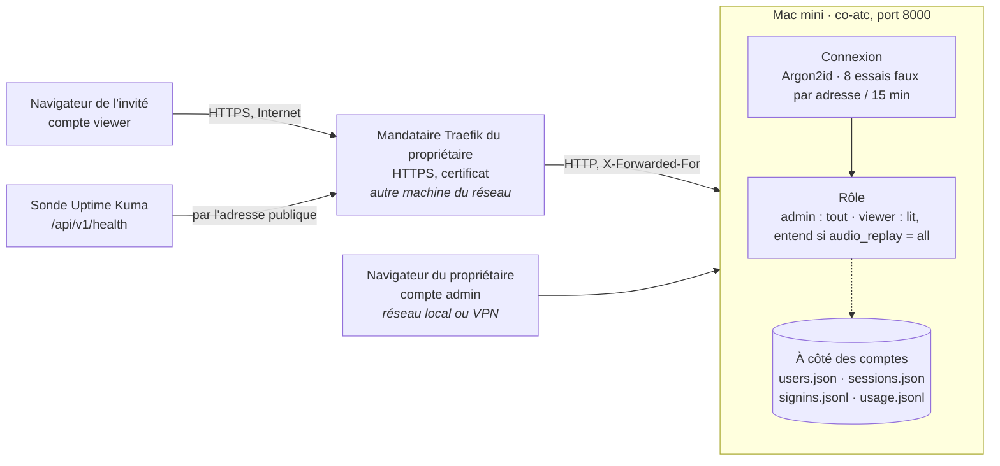

# Comptes et accès distant

> **Référence, vérifiée le 27/10/2026** sur la production et dans le code (commit `2229561`).
> Ce document décrit l'installation telle qu'elle tourne : qui peut ouvrir Clairance, par où,
> avec quels droits, et ce que le propriétaire en voit. Les décisions qui l'ont construite sont
> dans `05-decisions.md` (D70, D83, D84 ; Q62 pour l'accès d'un invité), le déroulé jour par
> jour dans la section « État » de `32-audit-produit.md`, les étapes dans `35-plan.md` (bloc D).

## Le chemin

- **Tout passe par le premier port.** Par le mandataire, la page, l'API, le WebSocket (en `wss`)
  et le son arrivent sur le port 8000 ; les ports 8001 à 8004 ne sont pas joignables de
  l'extérieur et la page ne les demande pas (D1, D2 du plan 35).
- **Le mandataire est déclaré, et lui seul** : `[server] trusted_proxies` contient son adresse.
  Le serveur croit alors ses en-têtes `X-Forwarded-For` et `X-Forwarded-Proto` (de lui seul),
  marque le cookie `Secure`, refuse la page de premier démarrage à ce qui vient par lui, et
  refuse de tourner sans connexion.
- **La connexion est obligatoire partout**, y compris sur le Mac : le serveur écoute sur toutes
  les interfaces depuis le 01/10 (D70), et un serveur joignable du réseau sans compte refuse de
  démarrer.

## Les comptes et leurs droits

| | admin (`owner` dans le code) | viewer |
|---|---|---|
| Carte, avions, transcriptions | oui | oui |
| Son en direct et réécoute des extraits | oui | **si `[server] audio_replay = "all"`** ; deux flux d'une fréquence au plus |
| Réglages, sources, mode d'accès | modifie | ne modifie rien |
| Adresses des flux et du récepteur, chemins des bases et du journal | les voit | **masqués** dans tout ce qu'il lit (`internal/api/guest.go`) |
| Comptes, trace des connexions, usage | les voit et les gère | n'y a pas accès (403) |

- **`audio_replay` est un réglage global**, pas une permission par compte : à `"all"`, tous les
  comptes viewer, présents et futurs, entendent le son. En production depuis le 27/10 à 16:59.
  Le changer demande une relance.
- **Les mots de passe** sont hachés en Argon2id ; jamais écrits ailleurs (ni journal, ni trace,
  ni réponse). 10 caractères au moins depuis la page. Huit essais faux par adresse (par /64 en
  IPv6) et par quart d'heure, puis refus.

## Gérer les comptes depuis la page

Réglages › Account › **Accounts**, visible du seul admin (D83, en production depuis le 27/10 à
15:37). Pour chaque compte : son rôle, ses sessions ouvertes, sa dernière activité, sa dernière
connexion et d'où.

- **Add an account** : nom, mot de passe, rôle (viewer par défaut). Le compte peut se connecter
  aussitôt, sans relance.
- **New password** : l'ancien cesse de marcher ; le compte est déconnecté partout (sauf le
  navigateur qui le change, s'il s'agit du sien).
- **Cut access** : ses sessions sont révoquées et **ses pages et son son coupés dans la
  seconde** ; le mot de passe est gardé, il peut se reconnecter. Pour le tenir dehors, lui
  donner aussi un nouveau mot de passe.
- **Remove** : le compte disparaît, ses pages sont coupées.
- **Garde-fous** : on ne se coupe ni ne se retire soi-même ; le dernier admin ne se retire pas ;
  un compte écrit à la main dans `config.toml` (`[[auth.users]]`) est montré mais ne se modifie
  pas depuis la page (le programme ne réécrit jamais ce fichier) — il peut être coupé.

`co-atc -add-user <nom>` existe toujours : il imprime un bloc `[[auth.users]]` à coller dans la
configuration, pour un serveur qu'on prépare avant de l'ouvrir.

## Les sessions

- **Gardées sur disque** (`configs/sessions.json`, empreintes des cookies seulement) depuis la
  fiche S : **une relance ne déconnecte personne** (« Sessions read back: N kept » au journal).
- **30 jours sans usage** et la session expire (`[auth] session_ttl_hours = 720` par défaut) ;
  le cookie suit, renouvelé une fois par jour au plus ; **90 jours après la connexion**, on se
  reconnecte quoi qu'il arrive.
- Une session dont le compte a disparu, ou n'a plus le rôle avec lequel elle a été ouverte, est
  refusée.

## Ce que le propriétaire voit

- **La trace des connexions** : chaque connexion, refusée ou non, et chaque déconnexion, avec
  l'adresse du client, son navigateur et l'heure, plus chaque changement fait depuis le panneau
  et par qui (`configs/signins.jsonl`, deux fichiers de 1 Mo au plus ; `GET /api/v1/signins`).
- **L'usage par compte** (D84, en production depuis le 27/10 à 20:13), Réglages › Account ›
  **Usage** :
  - *Now* : qui a une page ouverte et quelles fréquences il entend, rafraîchi toutes les 15 s ;
  - par compte, sur 7 jours : temps connecté, temps d'écoute par fréquence (deux onglets comptés
    une fois), extraits réécoutés, visites, une barre par jour ;
  - *Interruptions* : page ou son coupés par un arrêt du serveur, par la fin du flux de la
    station, ou par une connexion perdue puis revenue, avec le délai de reprise. Une page laissée
    en veille n'en est pas une.
  - Journal `configs/usage.jsonl`, écrit à la fin de chaque page, flux ou réécoute, **sans
    adresse** ; 30 jours gardés (`[auth] usage_days`, 0 le coupe). Rien n'est noté sans
    connexion, faute de compte.

Les quatre fichiers (`users.json`, `sessions.json`, `signins.jsonl`, `usage.jsonl`) sont à côté
des comptes, en lecture pour le seul utilisateur du Mac, et hors du dépôt (`.gitignore`).

## Surveiller l'accès

- **Sonde Uptime Kuma n°26** du propriétaire, « HTTP(s) - Keyword » sur `/api/v1/health` par
  l'adresse publique, mot-clé `"status":true` (vrai quand co-atc répond et que l'ADS-B arrive),
  toutes les 60 s, deux reprises à 20 s (posée le 27/10, D5).
- **Limite connue** : Kuma tourne sur la même machine que le mandataire, sur l'onduleur qui
  saute (deux redémarrages le 19/10). Si cette machine tombe, la sonde tombe avec elle et
  n'alerte pas. Une sonde extérieure reste à décider.
- `/api/v1/health` répond sans connexion et ne dit que l'état de l'ADS-B et le nombre d'avions ;
  le détail (`/api/v1/health/detail`) est réservé à l'admin et au Mac lui-même (le lanceur).

## Le débit

Mesuré le 27/10 :

- **Montant du Mac : 383 à 423 Mbit/s** (`networkQuality`, deux passes, production en marche).
- **Un auditeur : 64 kbit/s par fréquence**, 128 pour les deux : le son part en μ-law au rythme
  du flux de la station (8 kHz, 8 000 octets/s ; 7 987 o/s mesurés sur un flux passé par le
  mandataire). Les 16 kHz de la transcription ne le concernent pas.
- Les auditeurs tirent leur son de co-atc, pas d'Icecast : la station ne voit qu'un auditeur par
  fréquence, quel que soit le nombre d'invités.

## Pas à pas

**Ouvrir l'accès à un invité**
1. Réglages › Account › Accounts › *Add an account* : son nom, un mot de passe de 10 caractères
   au moins, rôle *viewer*.
2. Lui transmettre l'adresse publique, son nom et son mot de passe.
3. Pour qu'il entende le son : `audio_replay = "all"` dans `[server]`, puis une relance (global,
   déjà fait le 27/10).
4. Vérifier dans *Usage* › *Now* qu'il apparaît, et ce qu'il écoute.

**Lui couper l'accès**
- Pour un moment : *Cut access*. Il peut revenir avec le même mot de passe.
- Pour de bon : *Cut access* puis *New password*, ou *Remove*.
- Dans les deux cas, rien à relancer.

**Savoir ce qu'il a fait** : *Usage* (sa semaine, ses interruptions), et la trace des connexions
pour l'adresse d'où il est venu.
